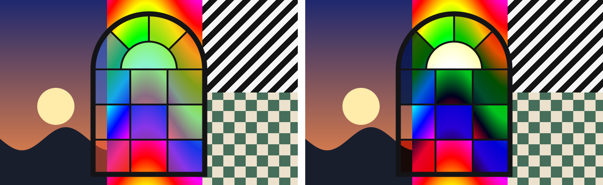
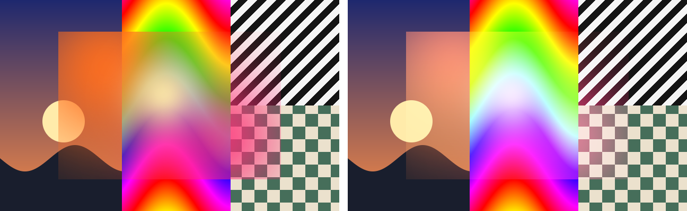
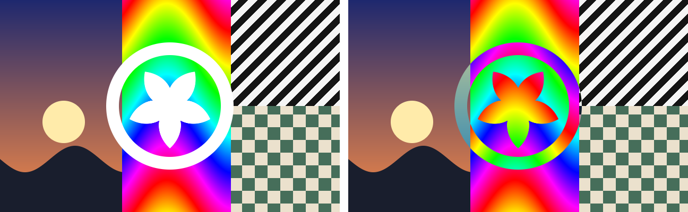
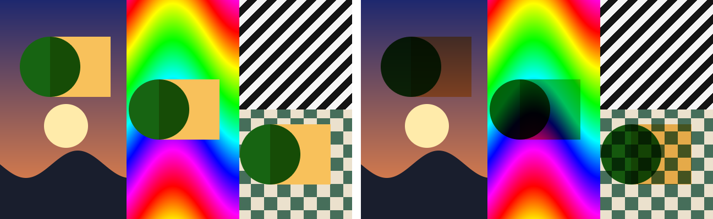
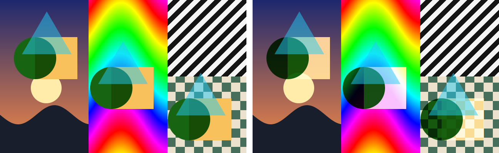
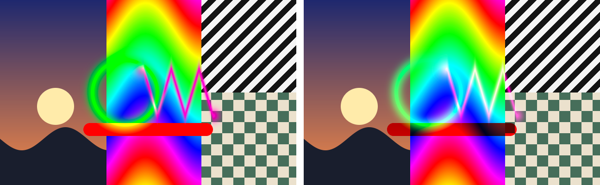

# Vitral

**Blend modes that survive export.**

Vitral is a proposal for an image format that carries its own blend modes.
What multiplies in Figma, Illustrator or Photoshop keeps multiplying on the
website, without anyone rebuilding it: multiply, screen and their relatives,
mixed freely per pixel in one PNG.

PNG has transparency. Vitral has light and filter.

It is also a valid PNG. Where nothing is behind it, and in software that has
never heard of Vitral, it shows each pixel's own colour: the same image a normal
PNG export would give you. It is never worse than the PNG you would export
today.

| Any PNG viewer (left) vs Vitral (right), same file over the same backdrop |
|---|
|  |
|  |
|  |
|  |
|  |
|  |

> Status: **proposal, draft 0.1** (October 2026). The format, the Rust
> reference implementation, the command-line tool and the web polyfill work;
> everything may still change. This project was first published as "GFI
> (Graphic Function Image)".

## Why

A blend mode lives in the design tool, not in the file. Export a layer set to
multiply and you get a flat PNG: on a different background it looks grey and
dirty instead of tinting what is behind it. Design forums have answered the
same question for years with "the blending mode can't be carried with an
image". So someone downstream rebuilds the effect by hand (separate layers and
CSS `mix-blend-mode`), or the artwork gets flattened over one background and
breaks when that background changes: dark mode, a client's theme, a photo that
rotates.

Vitral keeps the blend in the image, so the designer's intent reaches the place
where the image is used.

## What it does, and what it does not do yet

| Blend modes | In Vitral 0.1 |
|---|---|
| Normal, multiply, screen, hard light, exclusion, inversion, with opacity, mixed per pixel and stacked | Exact |
| Add (linear dodge), linear burn, darken, lighten, difference | Approximate: exact over black and white, linear in between |
| Overlay, soft light, colour dodge, colour burn, hue, saturation, colour, luminosity | Not yet |
| Background blur, refraction | Not yet |

* **It works where Vitral is supported.** Today that means websites with the
  polyfill script; a Figma plugin is next. Image viewers, email, slides and
  native apps show the normal PNG.
* **On the web it blends with content in its own stacking context**, like CSS
  blend modes do: an ancestor with `opacity`, `transform` or `isolation`
  isolates it.
* **Files are larger**: 2.5 to 4.7 times the plain PNG in the samples.

Growing the format past these limits is the point of the proposal (see the
[roadmap](#roadmap)).

## A proposal, open to help

Vitral is published as a proposal so that people interested in the problem can
try it, break it and help improve it. Useful ways to help:

* Try it with your own exports (the [demo](https://hugovalepereira.github.io/vitral-image-format/)
  has an encoder) and open an issue with what worked and what did not.
* Describe a case where you had to rebuild a blend by hand, or where Vitral's
  limits got in the way.
* Read the [specification](SPEC.md) and question it, or implement it in another
  tool or language.
* Propose how overlay, soft light or background blur could fit into a future
  version.

## How it works

Every pixel channel is a function of the backdrop value *b* behind it:

```
result = K + (W − K) × b
```

*K* is how the pixel looks over black and *W* how it looks over white. That
straight line reproduces normal, multiply, screen, hard light, exclusion and
inversion exactly, mixed freely per pixel and stacked in any order. A plain PNG
pixel is the special case where W − K is the same grey on all three channels.

The file stores the artwork's native look (its own colours, as exported over a
transparent background) as the main PNG image, plus a `viTr` chunk holding the
residual needed to rebuild K and W exactly. To draw it, a renderer stacks three
layers with blend modes every host already has: **difference**, **screen**,
**multiply**. Read the full [specification](SPEC.md).

## Quick start

### Make a Vitral image from any design tool

Export your artwork over a black background and over a white background (keep
the layers' blend modes active), and optionally once more with a transparent
background, then run the command below. The exports can be sRGB or Display P3;
the file keeps their colour space and blends in it, as the design tool did.

```sh
cargo install --path crates/vitral-cli        # installs the `vitral` command
vitral encode --black art-on-black.png --white art-on-white.png \
              --transparent art.png -o art.vitral.png
```

Keep the artwork in a pass-through group (in Photoshop a Pass Through group, in
Illustrator with "Isolate Blending" off), so its blend modes reach the black and
white backgrounds.

Other commands:

```sh
vitral from-image shadow.png --mode multiply -o shadow.vitral.png
vitral compose --layer glass.png:multiply --layer shine.png:screen:0.4 -o card.vitral.png
vitral render art.vitral.png --backdrop photo.png --x 40 --y 20 -o preview.png
vitral inspect art.vitral.png
vitral decode art.vitral.png --out-dir layers/
```

### Use it on a website

```html

<script type="module" src="web/vitral.js"></script>
```

The script decodes the file with WebAssembly and stacks three canvases with CSS
`mix-blend-mode`. Without JavaScript the page shows the fallback. As with CSS
blend modes, the image blends with content in its own stacking context.

The demo page (`web/index.html`) compares a plain PNG viewer with Vitral over
several backdrops and includes an encoder. You can open your own `.vitral.png`
(or drop it on the comparison), or send the encoder's result to the backdrops.
It is published from the `main` branch (root folder) at
<https://hugovalepereira.github.io/vitral-image-format/>. Locally, serve the
repository root with any static server and open `/web/`:

```sh
python3 -m http.server 8000    # then open http://localhost:8000/web/
```

## Repository

| Path | Contents |
|---|---|
| [`SPEC.md`](SPEC.md) | Format specification (draft 0.1) |
| [`crates/vitral`](crates/vitral) | Rust reference implementation: codec, reference compositor, W3C blend modes, render planes |
| [`crates/vitral-cli`](crates/vitral-cli) | `vitral` command-line tool |
| [`crates/vitral-wasm`](crates/vitral-wasm) | WebAssembly bindings |
| [`web/`](web) | Polyfill (`vitral.js`), demo page and its images in `web/samples`, prebuilt WebAssembly in `web/pkg`, browser tests |
| [`examples/`](examples) | Sample files, the two source exports of one sample, comparison renders |
| [`docs/pt/`](docs/pt) | Planning documents in Portuguese: state of the art, requirements, decisions, roadmap |

## Development

```sh
cargo test --release                                  # unit and round-trip tests
cargo run --release -p vitral --example samples       # regenerate examples/
python3 tools/demo_samples.py                         # regenerate web/samples/ (demo page images; needs numpy, Pillow)
./web/build.sh                                        # rebuild web/pkg (needs wasm-bindgen-cli 0.2.129)
node web/test/run.mjs                                 # Chromium vs reference compositor (needs Playwright)
```

## Roadmap

1. **Done in 0.1**: specification draft, Rust implementation, CLI, web polyfill,
   demo.
2. **Next**: Figma plugin (export and import), playground and packages on
   crates.io and npm, conformance test suite, fuzzing.
3. **Then**: Illustrator, After Effects and Photoshop scripts; Vitral video for
   light leaks and overlays.
4. **v2**: layers with overlay, soft light and HSL modes; backdrop blur and
   refraction; 16-bit and wide gamut.

The detailed plan, including promotion, is in
[`docs/pt/04-plano.md`](docs/pt/04-plano.md).

## License

MIT. The specification is free to implement without royalties.
